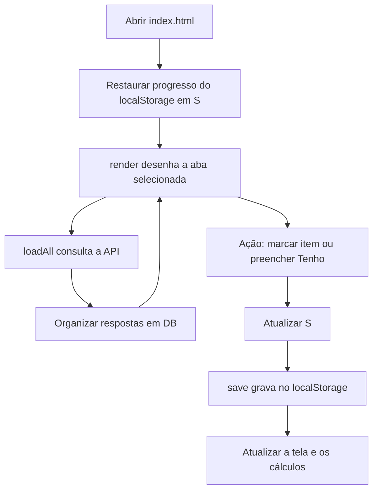

# Aprendendo com o Assistente Tarkov Web

Comece por este guia e depois abra `index.html` em um editor de código. Os comentários explicam os blocos principais perto das funções que eles descrevem. Comentários ajudam quem lê o arquivo; não aparecem na interface nem são executados.

## 1. Quais ferramentas este projeto usa?

| Tecnologia ou ferramenta | Papel neste projeto | Onde observar |
| --- | --- | --- |
| HTML | Estrutura da página: botões, campos, abas e seções expansíveis | `<header>`, `<nav>`, `<main>`, `<details>` |
| CSS | Cores, tamanhos, colunas, estados visuais e adaptação a telas pequenas | Bloco `<style>` |
| JavaScript | Busca dados, faz cálculos, filtra itens e responde às ações | Bloco `<script>` |
| DOM | Representação da página que o JavaScript consulta e modifica | `querySelector`, `textContent`, `innerHTML` |
| Fetch API | Recurso do navegador para consultar dados pela internet | `getJSON()` |
| JSON | Formato de texto usado na API e no salvamento | `response.json()`, `JSON.parse`, `JSON.stringify` |
| localStorage | Armazenamento do progresso neste perfil do navegador | `S`, `save()` |
| API do tarkov.dev | Fonte externa de itens, preços, construções e trocas | Constante `API` e `loadAll()` |
| Git | Histórico de versões dos arquivos | Commits do repositório |
| GitHub | Hospeda o código e seu histórico para acesso e compartilhamento | Página do repositório |
| GitHub Desktop | Ajuda a baixar, atualizar e enviar versões pelo computador | **Fetch origin**, **Pull origin**, **Changes**, **History** |

O aplicativo usa HTML, CSS e JavaScript diretamente no navegador. Não depende de React, jQuery, banco de dados de servidor ou instalação de pacotes. O símbolo `$` é apenas um atalho definido no próprio código.

## 2. A visão geral



Há três conjuntos de dados diferentes:

- **`S`**: progresso salvo, como marcações, quantidades, categorias selecionadas e níveis concluídos.
- **`DB`**: catálogo e preços consultados na API. Ficam em memória e são buscados novamente quando a página abre.
- **`UI`**: controles temporários, como busca, ordenação e limite de resultados. O estado das estações abertas é restaurado de `S.hideoutOpen`.

## 3. Como ler o arquivo

No editor, use a busca para localizar os nomes abaixo, nesta ordem:

| Procure por | O que aprender |
| --- | --- |
| `:root` | Como alterar as cores reutilizadas no CSS |
| `.row` e `@media` | Como as colunas e as telas menores são organizadas |
| `<nav id="tabs">` | Como os botões identificam suas abas com `data-tab` |
| `const DEF` e `const save` | Como o progresso é restaurado e salvo |
| `const DB` e `const UI` | Diferença entre catálogo, progresso e controles |
| `getJSON` e `localized` | Como consultar dados e traduzir nomes |
| `loadAll` | Como coordenar as consultas e lidar com falhas |
| `markKey` | Como separar marcações de construções diferentes |
| `remaining` e `markedRows` | Como calcular Faltam e o custo restante |
| `viewItems`, `viewMarked`, `viewHideout`, `viewBarters`, `viewQuests` | Como cada aba monta seu conteúdo |
| `render` | Como o conteúdo escolhido chega à tela |
| `addEventListener` | Como o código recebe cliques e digitação |

## 4. Exemplo: Tenho e Faltam

Uma marcação possui, entre outros, estes campos:

```js
{
  itemId: 'id-do-item',
  qty: 10,     // Necessidade obtida quando o item foi marcado.
  owned: 4    // Quantidade que a pessoa informou em Tenho.
}
```

A função usada pelo aplicativo é:

```js
const remaining = mark => Math.max(0, mark.qty - mark.owned);
```

`=>` cria uma função. Ela recebe `mark`, subtrai `owned` de `qty` e devolve o resultado. `Math.max(0, ...)` impede um valor negativo: ter 12 de uma necessidade de 10 significa que faltam zero.

Se o preço estimado for 20.000 ₽ e faltarem 6, o custo restante será `6 * 20000`, ou 120.000 ₽. Quando não há preço conhecido e ainda faltam unidades, o custo aparece como **—**. Quando não falta nada, o custo restante é zero, mesmo sem preço disponível.

`collectOne()` recebe o produto do botão azul, acrescenta uma unidade ao estoque agrupado e distribui esse estoque entre as origens sem duplicar unidades. Em seguida salva e redesenha a aba. Quando não falta mais nenhuma unidade, as marcações desse produto são removidas automaticamente.

## 5. Por que o mesmo item não marca todas as construções?

O produto possui um ID. Uma necessidade de construção precisa de uma identificação mais específica:

```text
Marcação geral: id-do-item
Construção A:   hideout:estacao-A:1:id-do-item
Construção B:   hideout:estacao-B:2:id-do-item
```

`markKey()` monta essas chaves. `source` guarda estação, nome da estação e nível. Assim, cada necessidade possui seu próprio `qty` e `owned`.

`toggleMark()` marca ou desmarca uma necessidade. `addMark()` é usado ao marcar um nível inteiro e preserva as quantidades que já estavam informadas. Clicar outra vez no botão do nível não soma todos os requisitos novamente.

As marcações gerais antigas continuam disponíveis; não é possível descobrir automaticamente de qual construção elas vieram, pois essa origem não era salva antes.

## 6. Como os dados e os filtros funcionam

`getJSON()` consulta um endereço como `https://json.tarkov.dev/pve/items`. `fetch()` recebe a resposta HTTP e `response.json()` converte o conteúdo em um objeto JavaScript. `async` e `await` permitem esperar os dados enquanto o navegador continua atendendo a interface.

`localized()` consulta também os arquivos de tradução. `normalizeItems()` adapta as respostas para os campos usados na aplicação. `DB.map.get(id)` recupera um item pelo seu identificador.

Em `viewItems()`:

1. `filter()` aplica a busca por texto e a opção de marcados.
2. Outro filtro aceita as categorias selecionadas.
3. `sort()` ordena os resultados.
4. `slice()` escolhe quantos serão exibidos.
5. `map()` monta o HTML de cada linha e `join('')` reúne os trechos.

Selecionar Alimentos e Bebidas mostra itens de **uma ou outra** categoria. Acrescentar uma busca exige que o resultado também corresponda ao texto.

`price()` segue uma ordem de alternativas para estimar valor: última oferta do flea, média de 24 horas, menor compra no comerciante e melhor venda. O valor de venda ao comerciante não representa necessariamente um preço pelo qual é possível comprar o item. A coluna de flea mostra o campo de coleta fornecido pela API.

## 7. Pequenos símbolos que aparecem bastante

| Expressão | Significado no código |
| --- | --- |
| `const` | Declara uma referência que não será reatribuída; um objeto declarado assim ainda pode ter seus campos alterados |
| `let` | Declara uma variável que pode receber outro valor |
| `obj.campo` | Acessa uma propriedade de um objeto |
| `obj?.campo` | Acessa a propriedade se o objeto existir, evitando erro por `null` ou `undefined` |
| `a ?? b` | Usa `b` se `a` for `null` ou `undefined`; mantém um zero válido |
| `a || b` | Usa `b` se `a` for um valor considerado falso, incluindo zero e texto vazio |
| `condicao ? a : b` | Escolhe entre dois valores conforme a condição |
| `...obj` | Copia propriedades de um objeto para outro; não faz uma cópia profunda |
| `Map` | Coleção para localizar valores por uma chave |
| `Set` | Coleção que evita valores repetidos |
| `data-act="mark"` | Informação no HTML que o código lê como `elemento.dataset.act` |
| `classList.toggle(...)` | Adiciona ou remove uma classe visual |

## 8. Onde o progresso fica salvo?

`localStorage.setItem('tkv-app', JSON.stringify(S))` grava o estado como texto. Ao abrir novamente, `JSON.parse()` reconstrói o objeto salvo. O código também adapta registros antigos ao formato atual.

O armazenamento pertence ao navegador, ao perfil e ao endereço/arquivo. Abrir em outro navegador, limpar os dados ou passar do arquivo local para um endereço hospedado não transfere o progresso automaticamente. GitHub armazena os arquivos do projeto; não recebe automaticamente seu `localStorage`.

## 9. Exercícios para visualizar mudanças

Faça os exercícios em uma cópia do arquivo ou em uma branch de estudo:

1. Altere `--gold` em `:root`, salve e recarregue a página para observar a cor de destaque.
2. Localize `CATEGORIES` e altere o `label` de uma categoria. Preserve `id` e `slugs`, que conectam os filtros aos dados.
3. No console das ferramentas do navegador, execute `remaining({qty: 10, owned: 4})`. O resultado deve ser `6`. Esse exemplo apenas calcula um valor.
4. Abra as ferramentas do navegador e procure a área **Network/Rede**. Atualize os preços e observe as requisições ao domínio `json.tarkov.dev`.
5. Procure **Application/Aplicativo → Local Storage** (o nome varia conforme o navegador) para visualizar `tkv-app`. Observe sem apagar ou editar seu progresso.

No GitHub Desktop, use **Fetch origin** e depois **Pull origin**, quando disponível, para receber esta versão comentada. Em **Changes**, você pode comparar suas experiências antes de criar um commit. Comentários em HTML usam `<!-- ... -->`; em CSS usam `/* ... */`; em JavaScript deste arquivo usam `//`.


## 10. Como a aba Missões funciona

- `localized(mode, 'tasks')` consulta as missões e os textos traduzidos. Elas são carregadas uma vez por modo enquanto a página está aberta, sem novo download a cada atualização de preços.
- `normalizeTasks()` traduz nomes e descrições de objetivos e organiza IDs de trader, níveis mínimos, facções e pré-requisitos.
- `DB.traders` guarda nomes e endereços das fotos; `DB.taskMap` permite localizar uma missão pelo ID.
- `viewQuests()` monta os botões com retratos, o progresso do trader e as missões agrupadas pelo `minPlayerLevel`, que é o nível mínimo do jogador, não a lealdade do trader.
- `setQuestDone()` registra ou remove a conclusão em `S.questDone[S.mode][id]`. As escolhas são manuais e independentes entre PVE e PVP.
- `S.questOpen` preserva as seções de níveis e objetivos abertas. Assim, marcar uma tarefa não fecha as seções que a pessoa estava lendo.

A fonte fornece descrições dos objetivos; o aplicativo não cria diálogos narrativos ausentes. Missões anteriores, facção e outros requisitos podem impedir o acesso mesmo após atingir o nível indicado. Os campos de busca, nível e situação filtram apenas as missões do trader selecionado.
